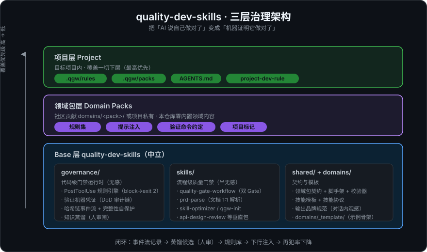

# quality-dev-skills

[](LICENSE)
[](https://github.com/woodsssnnn/quality-dev-skills/actions/workflows/quality-check.yml)
[](version.json)
[](skills/)
[](platforms/)

[English](README.en.md) | 中文

通用 AI 技能仓库。提供**代码治理运行时**、质量门禁工作流、技能优化框架、领域包开放机制和项目技能模板，可被任何项目复用——仓库保持中立，不含任何领域专属内容。



[贡献指南](CONTRIBUTING.md) | [行为准则](CODE_OF_CONDUCT.md) | [安全策略](SECURITY.md) | [版本历史](CHANGELOG.md) | [MIT License](LICENSE)

## 为什么需要它

AI 结对编程最大的信任问题：**agent 说自己做对了，你怎么证明？** 本仓库用两层机制回答——

- **governance 运行时（无感层）**：装上即生效、无需调用。写文件瞬间校验红线（密钥泄漏直接阻断、改完才放行）、本地验证自动落机器凭证、同一个坑重复踩会实时提醒。你看到的只是"agent 自己改对了"。
- **技能集（流程层）**：半无感，说"跑下质量门禁"即可触发。需求到代码全链路可追溯——PRD 1:1 解析 → 验收标准提取 → Plan 门禁 → 独立验证 → 报告。

| 没有它时 | 有它之后 |
|----------|----------|
| agent 声称"验证过了"（实际没跑） | 结论行与退出码交叉核验的机器凭证，一句 `--verify-last` 戳穿 |
| 密码/私钥/连接串硬编码入库 | 写入瞬间阻断 |
| 改契约字段，下游静默拿到 undefined | 自动提示先 grep 全部消费点 |
| 同一个坑这个会话踩、下个会话还踩 | 事件流记录频次，重复违规实时提醒 |
| PRD 细节在翻译成代码的路上丢失 | 验收标准提取 + 双 Gate + 独立 verifier |
| 团队规范写在 wiki 里没人看 | 规则是数据文件，违反即阻断 |

一句话：**把"AI 说自己做对了"变成"机器证明它做对了"。**

## 包含的技能

| 技能 | 说明 |
|------|------|
| `quality-gate-workflow` | 质量门禁工作流（需求→Plan→代码全链路验证，流程级） |
| `skill-optimizer` | 技能自动优化框架 |
| `prd-parse` | 原始需求文档 1:1 解析（pdf/doc/docx/xlsx/xls/html → Markdown） |
| `api-design-review` / `db-migration-gate` | 垂直技能包（API 设计审查 / DB 迁移门禁） |

## 治理运行时（governance/）

与技能（模型自主加载）互补的**代码级门禁**：PostToolUse 规则校验（block 违规
exit 2 强制 agent 继续修）、本地验证机器凭证（DoD 审计链）、SHA-256 哈希链事件
流、SessionStart 完整性自保护、知识蒸馏（增量水位 + 人审闸）。规则与配置全部
声明式、三层发现，详见 [governance/README.md](governance/README.md)。

## 领域包（domains/）

技术栈/团队把自己的门禁规则接入 governance 运行时的开放机制——本仓库只提供
契约、模板、脚手架与校验器，领域内容由社区贡献。见
[shared/domain-pack-spec.md](shared/domain-pack-spec.md) 与
[domains/_template/](domains/_template/)。

## 模板

| 模板 | 说明 |
|------|------|
| `project-dev-rule-template` | 项目开发规范技能模板（AI会话内生成） |

## 安装

### 插件市场（推荐，整仓即插件）

ZCode / Claude Code 的"添加插件市场"直接填 GitHub 地址：

```
woodsssnnn/quality-dev-skills
```

装上即得全家桶：6 个技能 + governance 代码门禁运行时 + 3 个 agent 模板。
> 已知边界：hooks 为 Windows 优先（.cmd 包装），mac/linux 技能可用、hooks 跨平台适配中。

### 脚本安装（软链，改源码立即生效）

```bash
git clone https://gitcode.com/songnan/quality-dev-skills.git ~/quality-dev-skills
cd ~/quality-dev-skills
bash scripts/install.sh
```

## 项目集成

本仓库是 **Base 层**，完全独立，不依赖任何项目层。

### 三层架构

```
项目层     目标项目内：.qgw/ 覆盖（最高优先）+ AGENTS.md + project-dev-rule (AI生成)
领域包层   domains/<pack>/（社区贡献）或 .qgw/packs/<pack>/（项目私有）——声明式规则/提示/验证约定
Base 层    quality-dev-skills：
           ├── governance/            代码级治理运行时（hooks + 规则引擎 + 事件流）
           ├── skills/                流程级质量门禁 + 技能优化 + prd-parse 等
           └── shared/                技能模板 + 领域包契约 + 协议
```

### 项目技能生成

1. 在项目空间启动AI会话
2. 读取 `shared/project-dev-rule-template/INDEX.md`
3. AI根据模板+项目上下文生成 `project-dev-rule`
4. 更新 `CLAUDE.md` / `AGENTS.md` 约束

### 项目覆盖

项目层通过 `.qgw/` 覆盖机制添加项目专属内容，不修改 base 层文件。

## 版本管理

### 版本信息

```bash
# 查看当前版本
cat version.json | grep version

# 检查版本兼容性
bash scripts/check-compatibility.sh -t 1.0.0 -p 1.0.0
```

### 更新项目技能

```bash
# 更新project-dev-rule到最新版本
bash scripts/update-project-skill.sh /path/to/project
```

## 多平台支持

本项目支持多种AI编码工具平台：

| 平台 | 适配器 | 安装方式 |
|------|--------|----------|
| **Claude Code** | `platforms/claude-code/` | 插件安装 |
| **Codex** | `platforms/codex/` | 插件安装 |
| **OpenCode** | `platforms/opencode/` | 服务器插件 |
| **MiMoCode** | `platforms/minicode/` | 插件安装 |
| **ZCode** | `platforms/zcode/` | 插件市场（`python scripts/build-zcode-plugin.py` 后 `/plugin marketplace add <repo>/dist`） |
| **通用** | `platforms/general/AGENTS.md` | 复制AGENTS.md |

详见 [多平台兼容方案](#多平台支持)。

## 更新

```bash
cd ~/quality-dev-skills
git pull
bash scripts/install.sh --update
```

## 致谢

本项目的设计与实现借鉴了以下开源项目的理念与实践，在此向所有贡献者致以诚挚的感谢：

| 项目 | 借鉴内容 | 本项目中的应用 |
|------|---------|---------------|
| **[planning-with-files](https://github.com/nicepkg/planning-with-files)** | 5问题重启测试、2-Action Rule、3-Strike Error Protocol | 通用工作协议（`general-protocols.md`）、会话恢复机制 |
| **[Spec Kit](https://github.com/nicepkg/spec-kit)** | `/speckit.clarify` 结构化澄清、`/speckit.analyze` 交叉分析 | 需求澄清机制（多选题模式）、`--analyze` 跨 artifact 分析 |
| **[agent-spec](https://github.com/nicepkg/agent-spec)** | boundary enforcement、`stamp` 命令 | Gate 2 Step 2.5 变更范围检查、Git Trailer 可追溯性 |
| **[Autonoma](https://github.com/nicepkg/autonoma)** | agentic testing（静态+动态双层验证） | Gate 2 S4 静态验证 + S4.5 E2E 行为验证 |
| **[Ponytail](https://github.com/nicepkg/ponytail)** | YAGNI 检查清单 | PM 顾问 D6 维度：功能必要性、标准库替代、原生特性替代 |
| **[OpenSpec](https://github.com/nicepkg/openspec)** | delta specs（只描述变更部分） | `--incremental` 增量验证模式 |
| **[Python](https://www.python.org/)** | Python 3 标准库 | gate-enforcer.py、evaluate.py、verify-checkpoint.sh 的 JSON 解析与状态机实现 |
| **[JSON Schema](https://json-schema.org/)** | JSON Schema Draft-07 | acceptance-criteria-schema.json 验收清单格式规范 |

### 平台兼容致谢

本项目的多平台支持得益于以下平台的开放生态：

- **[Claude Code](https://claude.ai/)** (Anthropic) — Hooks 机制、SKILL.md 规范
- **[Codex](https://openai.com/)** (OpenAI) — 服务器插件架构
- **[OpenCode](https://github.com/opencode)** — 服务器插件接口
- **[MiMoCode](https://mimo.org/)** — 插件安装规范

> 本项目的核心理念：将社区最佳实践沉淀为可复用的 AI 技能，让每个开发者都能站在巨人的肩膀上。
